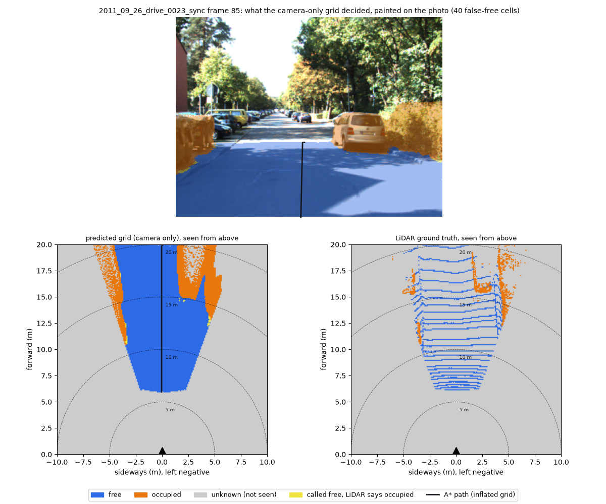
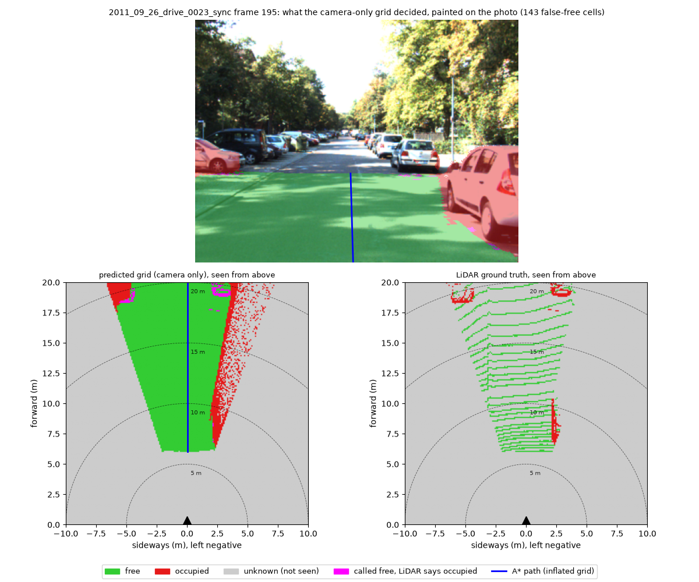
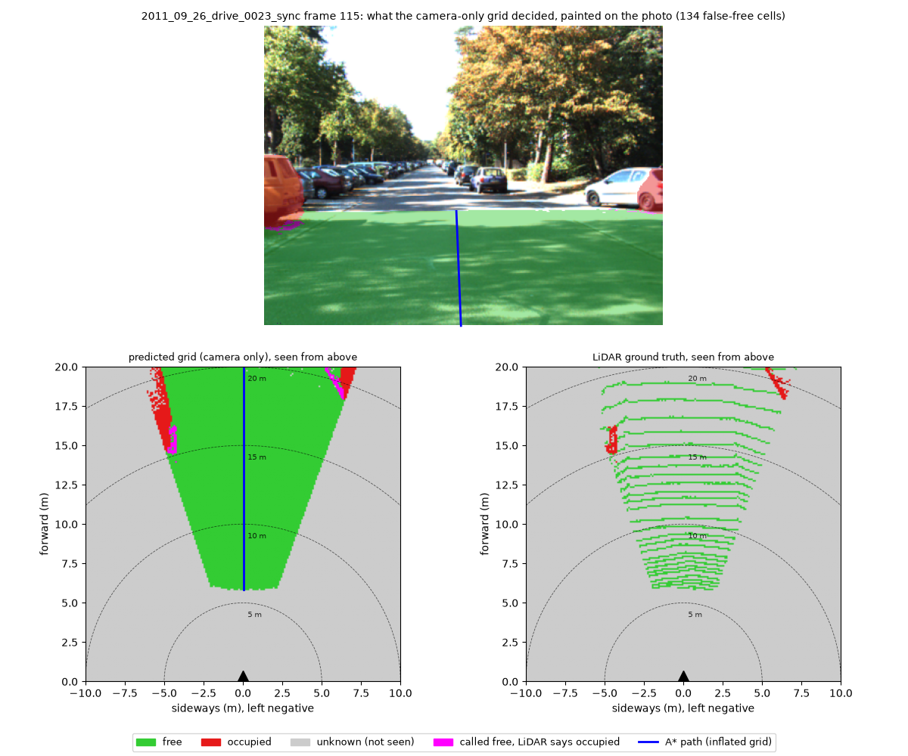
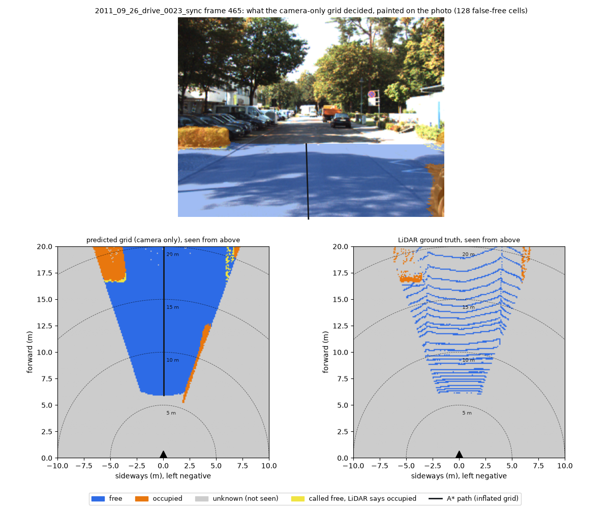
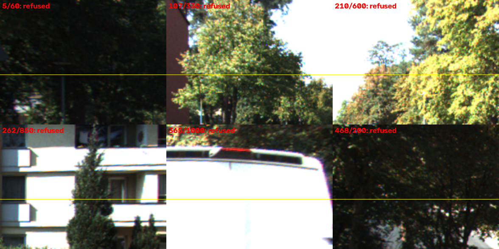

# Monocular Free-Space Perception

One ordinary photo in; a metric, top-down map of where a ground robot can drive out. No LiDAR, no stereo.

**Live demo: [monocular-freespace.vercel.app](https://monocular-freespace.vercel.app)**

**Distance error 5.4% · free-space agreement with LiDAR 91% · ground wrongly called free 0.16% with a 1 m safety margin · 0.46 s per photo on the server.** Accuracy: 47 frames, one KITTI drive; server time: median of 18 requests to the live service.
<!-- report/depth_eval_ship_finetuned_onnx.json: height.abs_rel = 0.0544, frames_total = 47 -->
<!-- report/freespace_ship_road_sidewalk_onnx.json: metrics.all.free_iou = 0.909, metrics.all.false_free_rate_inflated = 0.0016, robot_radius_m = 1.0 -->
<!-- report/space_check.json: samples.server_ms.total.median = 461.6, n = 18 -->



*A typical frame: KITTI drive 0023, frame 85, the frame with the median free-space agreement (IoU 0.908) of the 47 measured, at the app's input size. Top: the photo painted with the decision. Bottom left: the map built from the photo alone, with the planned path. Bottom right: the LiDAR's map, used only for grading. Yellow cells (40 here) were called free but the LiDAR saw an obstacle.*
<!-- report/freespace_ship_road_sidewalk_onnx.json: median_frame_free_iou = 0.9085; per_frame_free_iou, frame 85 = 0.9085; chosen_frames, frame 85, false_free_cells = 40 -->

---

## What it does

You give it one photo taken from a robot's point of view and say how high the camera was. It estimates how far away everything in the photo is, finds the floor, and draws a map seen from above with free ground, obstacles and the parts the camera cannot see. It then plans a path through the free ground, and refuses to answer when it cannot find a floor it trusts.

---

## Why this problem

> **[PLACEHOLDER — Bhaavin to write]**

---

## How it works

```
photo ──► depth network ──► 3D points ──► fit the floor plane ──► scale s = h / d
                                                │                     │
                                                │          refuse if the floor fit
                                                │          or the scale is implausible
                                                ▼
            points in a floor frame (height above floor) ──► ground / obstacle / hole
                                                ▼
             (optional) semantic check: flat counts as free only on road / sidewalk
                                                ▼
       top-down grid: FREE / OCCUPIED / UNKNOWN ──► inflate by robot radius ──► A* path
```

**The key idea: why one photo can't give metres, and how camera height fixes it.** A single photo has no built-in sense of size: a toy car close up and a real car far away can produce the same picture. A depth network learns typical sizes from its training data, so its "metres" are a guess that drifts with the camera and the scene. This project doesn't trust that guess for scale. It back-projects the depth map into 3D, fits a plane to the floor with RANSAC, and reads off the plane's distance `d` from the camera in the network's units. The real camera height `h` is known (you measure it once on the robot), so the true scale is simply `s = h / d`. Multiplying every depth by `s` puts the whole scene into real metres, anchored on the one thing we actually know.

**The safety check.** If the floor fit is unreliable (too tilted, too few inlier points), or if the resulting scale disagrees with the network's own metres by more than 2x (`s` outside [0.5, 2.0]), the app refuses and shows the reason instead of a map. A refusal is better than a confident wrong answer: a map at the wrong scale looks just as clean as a right one, and a robot would drive into the gap between them.

### Where to look in the code

| Step | File | What it does |
|---|---|---|
| Calibration and projection | [`freespace/camera.py`](freespace/camera.py) | Parses calibration, projects and back-projects points, turns LiDAR into depth maps |
| Floor fit | [`freespace/ground_plane.py`](freespace/ground_plane.py) | RANSAC plane fit with noise-adaptive refinement and a validity check |
| Metric scale and safety check | [`freespace/scale.py`](freespace/scale.py) | `s = h / d`, and the refusal when the plane or the scale is implausible |
| Occupancy grid | [`freespace/bev.py`](freespace/bev.py) | Builds the top-down FREE / OCCUPIED / UNKNOWN grid, visibility, inflation |
| Path | [`freespace/planner.py`](freespace/planner.py) | A* on the inflated grid, start and goal selection |
| Full pipeline | [`freespace/pipeline.py`](freespace/pipeline.py) | The whole chain for one image, with the models passed in as functions (no PyTorch) |
| Fine-tuning | [`training/finetune_depth.py`](training/finetune_depth.py) | Fine-tunes Depth Anything V2 on KITTI |
| Free-space evaluation | [`evaluation/eval_freespace.py`](evaluation/eval_freespace.py) | Grades the grid against the LiDAR grid, by distance band |

---

## Results

**Measured on 47 frames from one KITTI drive (`2011_09_26_drive_0023`, validation, not used for training), KITTI's front camera at 1.65 m, at the app's input size of 294 x 392 px, with the same ONNX models the server runs.** Evaluation on more drives is future work.

| What | Result | Meaning |
|---|---|---|
| Distance error (AbsRel) | **5.4%** <!-- report/depth_eval_ship_finetuned_onnx.json: height.abs_rel = 0.0544 --> | Something 10 m away is typically placed within ~0.5 m of the truth |
| ... by distance | 2.3% at 5-10 m, 3.9% at 10-20 m, 9.9% at 20-80 m <!-- report/depth_eval_ship_finetuned_onnx.json: range_stratified_height --> | Error grows with distance |
| ... without camera-height scaling | 12.5% <!-- report/depth_eval_ship_finetuned_onnx.json: raw.abs_rel = 0.1246 --> | The network's own metres, for comparison |
| Scale accuracy | **89%** of frames within 6% <!-- report/depth_eval_ship_finetuned_onnx.json: scale.frac_within_6pct = 0.894 (42 of 47) --> | Camera-height scale vs the best scale the LiDAR allows |
| Fine-tuning, like for like (both height-scaled) | AbsRel **7.5% → 5.4%** (28% smaller) <!-- report/depth_eval_ship_pretrained_pytorch.json: height.abs_rel = 0.0753; report/depth_eval_ship_finetuned_onnx.json: height.abs_rel = 0.0544 --> | Original model run in PyTorch, fine-tuned in ONNX (parity below) |
| Free-space agreement (IoU) | **91%** <!-- report/freespace_ship_road_sidewalk_onnx.json: metrics.all.free_iou = 0.909 --> | Of the ground either the camera or the LiDAR calls free, the share both call free (108,198 cells of 10 cm) |
| Free-space agreement, geometry only | 92% <!-- report/freespace_ship_geometry_onnx.json: metrics.all.free_iou = 0.918 --> | Without the road/sidewalk check |
| Missed obstacles | 14.1% <!-- report/freespace_ship_road_sidewalk_onnx.json: metrics.all.missed_obstacle_rate = 0.141 --> | LiDAR-occupied cells the camera did not mark occupied |
| Refusal test (pipeline level) | **6 of 6** refused <!-- report/azure/api_check.json: check "upper-image KITTI crops are refused (pipeline level)", crops[].status == refused --> | 150 x 200 crops from the top of six KITTI frames (trees, sky, a building, a van; no road), run locally through `pipeline.run` with the server's ONNX models by `backend/check_api.py`. They are smaller than the 294 px upload minimum, so they were not sent to the live service |

**False-free: ground called free that the LiDAR saw as blocked** (road + sidewalk mode). The safety margin is the robot's 1 m radius.
<!-- report/freespace_ship_road_sidewalk_onnx.json: metrics.*.false_free_rate, false_free_rate_inflated; robot_radius_m = 1.0 -->

| Distance ahead | Without margin | With margin |
|---|---|---|
| 0-10 m | 0.77% | 0.004% |
| 10-15 m | 1.7% | 0.17% |
| 15-20 m | 5.2% | 0.44% |
| **All** | **2.5%** | **0.16%** |

Notes:
- The fine-tuning comparison mixes PyTorch and ONNX; the ONNX parity check (below) puts the difference between the two at a median of 4e-7 relative, far below the gap measured here.
- At the full-width input (350 x 1218 px) the fine-tuning result is AbsRel 11.1% → 7.1% <!-- report/depth_eval_pretrained.json: height.abs_rel = 0.1107; report/depth_eval_m6_regression.json: height.abs_rel = 0.0707 -->. The full-width free-space numbers are not directly comparable: the app's 4:3 crop sees mostly the road straight ahead.
- In the refusal test, five crops were refused by the floor fit (plane tilted 35-173 deg) and one, a building facade with balconies, passed the floor fit (tilt 7.4 deg) and was refused only by the scale check, with `s` = 3.45 <!-- report/azure/api_check.json: crops[].reason, tilt_deg; frame 262 s from report/scale_focal.json: crops, frame 262, s = 3.451 (same crop, pipeline level) -->. That is why the scale check exists.

---

## Where it fails

<table>
<tr>
<td width="50%"><br>
<b>Frame 195:</b> the far ends of parked cars near the edge of the map were called free (yellow); far away, object outlines blur into the road. <!-- report/freespace_ship_road_sidewalk_onnx.json: worst_frames, 143 false-free cells --></td>
<td width="50%"><br>
<b>Frame 115:</b> the side of a parked car on the left, far ahead, slipped into the free area; the errors sit at the edges of objects. <!-- report/freespace_ship_road_sidewalk_onnx.json: worst_frames, 134 false-free cells --></td>
</tr>
<tr>
<td width="50%"><br>
<b>Frame 465:</b> two mistakes at once: car and hedge edges far ahead called free (yellow), and a strip of open road on the right marked blocked where the LiDAR saw free ground, the safe kind of mistake. <!-- report/freespace_ship_road_sidewalk_onnx.json: worst_frames, 128 false-free cells --></td>
<td width="50%"><br>
<b>No floor in view:</b> six crops without any road, all refused instead of producing a made-up map (pipeline-level check, see Results); the safe way to fail. <!-- report/azure/api_check.json: crops --></td>
</tr>
</table>

**Indoors:** a phone photo of an indoor corridor (camera 1.1 m high), sent as JPEG and as HEIC through the API of the local container and on the live site, is refused: the floor fit finds the floor (tilt 10 deg), but the scale comes out at 0.23, i.e. the street-trained network places the floor ~4x farther than the camera height allows. <!-- report/docker/api_check.json: phone_photos, status = refused, tilt_deg = 10.0, camera.height_m = 1.1; report/web_timing_raw.json: upload runs, status = refused; s = 0.227 / 0.224 from report/scale_focal.json: phones (pipeline level) --> The photo is not published.

---

## Engineering

| Part | What | Check |
|---|---|---|
| ONNX export | Both models exported with dynamic input size (the Depth Anything head is patched so the output size is not frozen at export time) | 20 KITTI frames: depth median relative difference 4e-7, max 6.5e-5 (thresholds 0.5% / 2%); segmentation label agreement 99.99995% (threshold 99.5%) <!-- report/onnx_parity.json --> |
| Backend | FastAPI on ONNX Runtime, CPU only, no PyTorch in the server | `backend/check_api.py` against the local container and the live service <!-- report/docker/api_check.json, report/azure/api_check.json --> |
| Container | `python:3.12-slim`, models downloaded at build time and pinned to one Hugging Face commit, so a cold start never downloads models; 284.1 MB compressed <!-- report/space_check.json: image_compressed_mb --> | Runs as a non-root user |
| Hosting | Azure Container Apps, 2 vCPU / 4 GiB, scale to zero when idle <!-- report/space_check.json: hardware --> | `deploy/space_check.py` |
| Frontend | React + Vite on Vercel; the grid, path and distance lines are drawn on canvas | Live browser timing log |
| Browser-side resize | JPEG/PNG/WebP uploads are shrunk to 1280 px in the browser before sending; the original's 35 mm focal length is sent along so the field of view stays right | `backend/check_api.py` checks the shrunk photo gives the same focal length as the original |

### Measured latency

| What | Time | Source |
|---|---|---|
| Server processing per photo (gallery) | **0.46 s** median, 0.48 s p90 (n = 18) | <!-- report/space_check.json: samples.server_ms.total --> live service |
| ... depth / segmentation / geometry | 248 / 105 / 82 ms median | <!-- report/space_check.json: samples.server_ms --> |
| Server, 12 MP JPEG upload | 0.57 s median (n = 3) | <!-- report/space_check.json: uploads_12mp.server_total_ms --> |
| Cold start (zero replicas → healthy) | 4.3 s median (n = 3) | <!-- report/space_check.json: cold_start.zero_to_health_s --> |
| Browser, click to picture, gallery | 2.4 s and 5.1 s (n = 2) | <!-- report/web_timing_raw.json --> Chrome, India → East Asia |
| Browser, 3.58 MB phone JPEG, **after** browser resize (sent 0.19 MB) | **2.2 s** median (n = 2) | <!-- report/web_timing_raw.json --> |
| Browser, same phone JPEG, **before** browser resize (sent 3.58 MB) | **10.5 s** (n = 1) | <!-- report/web_timing_before_resize.json: runs, "upload IMG_4328.JPEG (3.58 MB)", browser_ms = 10488.5 --> |
| Browser, 2.65 MB HEIC (browsers can't decode it, sent unshrunk) | 8.0 s (n = 1) | <!-- report/web_timing_raw.json --> |

Most of the browser time is network: the server itself takes under a second.

---

## Repository layout

| Folder | What |
|---|---|
| `freespace/` | The core: camera geometry, floor fit, scale, point labelling, grid, A*, and the PyTorch-free pipeline |
| `models/` | PyTorch wrappers for Depth Anything V2 and SegFormer-B0 (training and evaluation only) |
| `training/` | Fine-tuning on KITTI and ONNX export with the parity check |
| `evaluation/` | Depth and free-space evaluation against KITTI LiDAR, and the CPU benchmark |
| `checks/` | Smaller checks and investigations (projection, floor fit, pipeline equality, focal-aware scale) |
| `backend/` | FastAPI server, KITTI gallery builder, API check |
| `web/` | React + Vite frontend; `make_results.py` copies the numbers from `report/` |
| `deploy/` | Dockerfile, model-repo publishing, live-service measurement |
| `report/` | Every number and picture in this README |

### Reproduce the main results

All commands need KITTI raw drive `2011_09_26_drive_0023` with its calibration under `data/`, and the KITTI depth benchmark ground truth under `data/kitti_depth/` (KITTI's licence does not allow redistributing them here). Run from the repo root.

**From the published ONNX models alone** (no PyTorch weights needed): every number in the Results table except the full-width comparison, plus the CPU benchmark and the server check. First download the models, pinned to the commit the live server uses:

```bash
python -c "from huggingface_hub import snapshot_download; snapshot_download('BhaavinJain/monocular-freespace-models', revision='d272633e7b8f04109ead2adcb2b97d99299e423e', local_dir='checkpoints/onnx', allow_patterns=['*.onnx', '*.json'])"

# depth at the shipping size (distance error, scale accuracy)
python -m evaluation.eval_depth --depth_root data/kitti_depth --size 294 392 --onnx_dir checkpoints/onnx --tag ship_finetuned_onnx

# the original model at the same size, for the fine-tuning comparison (public checkpoint, downloaded by transformers)
python -m evaluation.eval_depth --depth_root data/kitti_depth --size 294 392 --tag ship_pretrained_pytorch

# free space at the shipping size (with and without the road/sidewalk check; --frames 85 also saves the hero picture)
python -m evaluation.eval_freespace --depth_root data/kitti_depth --size 294 392 --onnx_dir checkpoints/onnx --drivable road+sidewalk --tag ship_road_sidewalk_onnx --frames 85
python -m evaluation.eval_freespace --depth_root data/kitti_depth --size 294 392 --onnx_dir checkpoints/onnx --tag ship_geometry_onnx

# CPU latency per input size
python -m evaluation.benchmark --threads 2

# server image and its check, including the refusal test (start the container on port 7860 first)
docker build -f deploy/Dockerfile -t freespace:local .
python -m backend.check_api --url http://127.0.0.1:7860 --report_dir report/docker
```

**With the fine-tuned PyTorch weights** (`depth_best.pt`, published in the same model repo under the same non-commercial terms): the full-width input comparison and the ONNX export with its parity check.

```bash
python -c "from huggingface_hub import hf_hub_download; hf_hub_download('BhaavinJain/monocular-freespace-models', 'depth_best.pt', revision='188dc8d3d39d62d5a7b39ad163334a9ca2d186e7', local_dir='checkpoints')"

# full-width input (350 x 1218)
python -m evaluation.eval_depth --depth_root data/kitti_depth --tag finetuned --weights checkpoints/depth_best.pt
python -m evaluation.eval_freespace --depth_root data/kitti_depth --weights checkpoints/depth_best.pt --drivable road+sidewalk --tag finetuned_road_sidewalk

# ONNX export and parity
python -m training.export_onnx
```

---

## Limitations and future work

- **One drive.** Every accuracy number comes from 47 frames of one KITTI drive with one camera. Evaluating on more drives is the next step.
- **Other cameras are unmeasured.** Uploaded photos use the camera height and field of view you give (or the photo's EXIF). Every KITTI test had a focal length of 565-995 px; a typical phone photo at the app's size has ~290 px <!-- report/docker/api_check.json: phone_photos, camera.fx = 294.4 -->, outside anything tested. The upload mode is labelled experimental for this reason.
- **Indoor photos are refused.** The depth network is an outdoor model fine-tuned on German streets, and its metres are far off indoors (see above). The plan:
  1. switch to Depth Anything V2's indoor-trained metric checkpoint for indoor photos;
  2. optionally fine-tune it on indoor data;
  3. re-set the scale check's [0.5, 2.0] band for that model, since the band assumes the network is roughly metric;
  4. evaluate on NYU Depth v2 (known cameras, ground-truth depth), reporting depth error, free-space metrics, and how often the scale check refuses real floors.
- **Flat-floor assumption.** One plane is fitted to the floor. Slopes, ramps, stairs and curbs that change the floor height are not modelled.
- **Focal-aware scale check: investigated, not adopted.** Idea: a metric network bakes in its training focal length, so the expected scale should follow the camera's focal length, and the check could be normalised by it. On KITTI the scale does rise with focal length, but weakly (log-log slope 0.28, where 1 would be proportional) <!-- report/scale_focal.json: loglog_slope_s_oracle_on_fx = 0.282 -->. The normalised check would have **accepted** the building-facade crop (normalised 1.85, inside the band) <!-- report/scale_focal.json: crops, frame 262, normalised = 1.851; criteria.crops_all_refused_normalised = false -->, so it was rejected: it trades a refusal we need for one we don't.

---

## What I learned

> **[PLACEHOLDER — Bhaavin to write]**

## What I'd do differently

> **[PLACEHOLDER — Bhaavin to write]**

---

## Credits and licences

| Component | Licence |
|---|---|
| [KITTI](https://www.cvlibs.net/datasets/kitti/) (Geiger et al.): the gallery frames, LiDAR ground truth and fine-tuning data | CC BY-NC-SA 3.0 |
| [Depth Anything V2](https://github.com/DepthAnything/Depth-Anything-V2) Small | Apache-2.0 |
| Depth Anything V2 Metric-Outdoor-Small (the starting checkpoint) | No licence stated; trained on [Virtual KITTI 2](https://europe.naverlabs.com/research/computer-vision/proxy-virtual-worlds-vkitti-2/), CC BY-NC-SA 3.0 |
| The fine-tuned depth model (this project) | Derived from the above and from KITTI: non-commercial |
| [SegFormer-B0](https://github.com/NVlabs/SegFormer) (Cityscapes) | NVIDIA Source Code License, non-commercial |

**This project, its models and its demo are for non-commercial use only** (research, evaluation, education). The models and gallery are published at [BhaavinJain/monocular-freespace-models](https://huggingface.co/BhaavinJain/monocular-freespace-models). This table states what the sources say; it is not legal advice.
